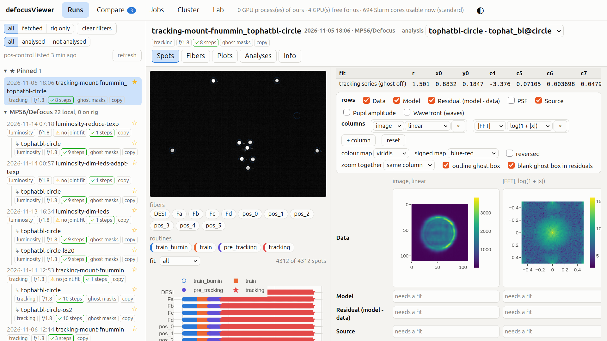

# defocusViewer



A browser GUI that helps analyse and visualise defocused light spots emitted by optical fibres, in the context of the
characterisation of robotic fibre positioners for spectroscopic surveys.

It is a small web service (FastAPI backend, plain ES-module frontend, vendored Plotly) on top of a tree of run directories
and a spot-fitting library based on Fourier optics (Zernike aberrations).

> **Scope.** This repository contains only the viewer. The acquisition code, the fitting library (`DefocusTest`), the run
> directory layer (`posUtils`) and the resource helpers (`amkit`) are separate packages that must be installed in the same
> environment. They are not public, so the viewer cannot be run from this repository alone.

## Features

**Runs**
- Browse the run directories on disk and the runs still on the lab computer, with each run's analysis variants grouped as one
  family.
- Filter the list by test type and f-number, by fetched or only on the lab computer, and by analysed or not analysed.
  Filters are remembered per browser.
- An Info page summarises a run: what was acquired, how it is fitted, and what the analyses found.
- Per-run figures and per-fibre series of the fit quantities and the focus offset (`delta_z`).

**Spots**
- Open a single spot with its acquisition metadata and its fit.
- View data, model, residual, PSF, source, pupil and wavefront as a matrix of panels, each as an image or as the magnitude of
  its Fourier transform.
- Show the model with or without the ghost mask. When no saved fit matches the requested setting, the viewer fits that spot
  itself, caches the result and leaves the run's results untouched.
- Export any panel as PNG, PDF or `.npy` (right-click).

**Compare**: pin spots from any runs and view them side by side.

**Analyses**
- Launch the analysis steps of a run from the browser, on GPUs or through Slurm.
- Re-analyse a run as a *variant* (another source model, aperture shape, wavelength range, f-number or image oversampling)
  without touching the run's own results.
- A viewer joint fit covers runs the standard pipeline cannot analyse, seeded from a reference run.

**Jobs and cluster**
- Each job has a state, a log and its resources.
- A second job on a run that is already being analysed is refused.
- The cluster page shows the GPUs and cores in use, and which of them belong to viewer jobs.

**Lab computer** (optional)
- Launch acquisition routines and follow the runs, the stage and the telescope mount, through a read-only probe over SSH.
  The viewer never opens the hardware.
- Stop a running routine with a stop file that the routine checks between stacks.

**Watchdog** (optional): fetches each run that finishes on the lab computer and analyses it on the GPUs when they are free.
See [WATCHDOG.md](WATCHDOG.md).

**Raw data**: the large `data/` folder of a run can live on separate storage, linked from the run directory.
`defocusviewer fetch` and `defocusviewer move-data` manage it.

## Install and run

```
pip install -e .                 # plus DefocusTest, posUtils and amkit in the same environment
defocusviewer serve              # starts the service (port 8765 by default)
defocusviewer url                # prints the login URL for your browser
```

Open the login URL once per browser: it sets a cookie that every other request needs. For long-running use, run `serve`
under tmux or systemd and call `defocusviewer ensure` from cron, which restarts the service if it stops answering.

## Configuration

Defaults are in [defocusviewer/config.py](defocusviewer/config.py). Override them, with the same names, in
`~/.config/defocusViewer/config.toml`. The login secret is stored next to it, in `token`. The main settings are the run
directory roots, the raw-data root, the lab devices to list, the hosts where analyses may run, and the port.

Browsing never writes into a run directory.

## Tests

```
python -m pytest tests
```

Some tests use a real run directory and are skipped without it.
